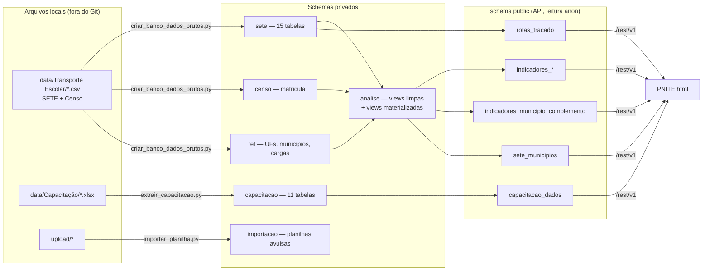
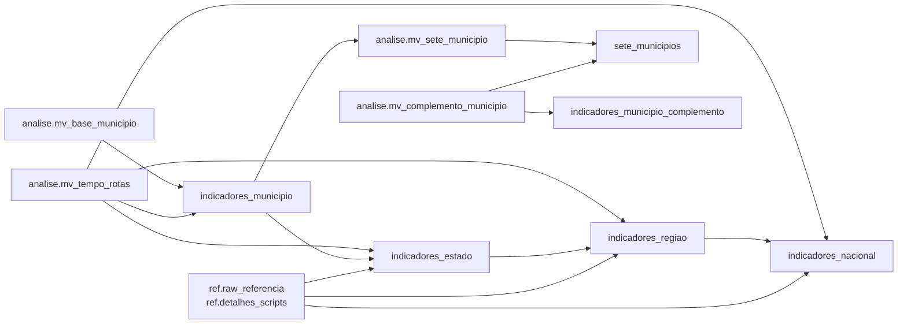

# PNITE — Banco de dados (Supabase)

Estrutura do banco que alimenta a **PNITE**: o que existe em cada schema, como os dados fluem dos arquivos brutos até a interface, quais regras de cálculo ficam no banco e como atualizar.

> Retrato de 22/10/2026 (migração `0014`), carga do SETE `ano_carga = 2026` e Censo Escolar 2025. Banco com cerca de 2,2 GB.
> A fonte da verdade da estrutura são as migrações em [`supabase/migrations/`](supabase/migrations/); este documento as resume.

---

## 1. Visão geral

- **Servidor:** Supabase self-hosted em `https://supabase.transportesufg.eng.br` (PostgreSQL 17 + PostGIS).
- **Duas portas de entrada:**
  - **Administração** (migrações e cargas): endpoint HTTPS `/pg/query`, com a **chave secreta** do `.env`, usado pelos scripts de [`scripts/`](scripts/). O Postgres não aceita conexão direta (portas 5432/6543 fechadas).
  - **Interface** (`PNITE.html`): API REST `/rest/v1/`, com a **chave publishable**, que só lê as views do schema `public`.
- **Privacidade:** os dados brutos têm dados pessoais (CPF, placa, coordenadas de alunos) e ficam em schemas privados, sem `GRANT` para `anon`/`authenticated`. A interface só recebe agregados.



---

## 2. Schemas

| Schema | Conteúdo | Acesso pela API |
|---|---|---|
| `sete` | Dados brutos do SETE (Sistema Eletrônico de Transporte Escolar), um registro por linha dos CSVs | não |
| `censo` | Microdados do Censo Escolar (matrículas por escola) | não |
| `ref` | Referências: UFs, municípios IBGE, pareamento de cargas, valores legados | não |
| `capacitacao` | Capacitações do Transporte Escolar (consolidadas, sem dados pessoais) | não |
| `importacao` | Planilhas enviadas pela pasta `upload/` (uma tabela por arquivo) | não |
| `analise` | Views de leitura limpa e views materializadas de cálculo | não |
| `pnite_meta` | Controle: migrações aplicadas, histórico de cargas, área de trânsito | não |
| `public` | **Somente** views materializadas agregadas, lidas pela interface | leitura (`anon`) |

---

## 3. Dados brutos

Todas as tabelas brutas têm `ano_carga` (ano de referência da carga), `codigo_cidade` (código IBGE de 7 dígitos) e `uf`. Os comentários de coluna no banco trazem as descrições do dicionário do SETE.

### 3.1. `sete` — SETE (`ano_carga = 2026`)

| Tabela | Linhas | Conteúdo |
|---|---:|---|
| `alunos` | 3.761.371 | Alunos cadastrados (deficiência, impedâncias no trajeto, turno, nível) |
| `escola_tem_aluno` | 2.797.574 | Vínculo escola × aluno |
| `rota_atende_aluno` | 1.234.532 | Vínculo rota × aluno (alunos transportados) |
| `rota_passa_por_escolas` | 163.650 | Vínculo rota × escola |
| `ordem_servico` | 91.990 | Ordens de serviço de manutenção |
| `rotas` | 82.887 | Rotas (km, tempo, tipo/modal, impedâncias, `tem_shape`) |
| `veiculos` | 67.730 | Frota (ano, origem própria/terceirizada, capacidade, tipo, modelo) |
| `escolas` | 65.860 | Escolas atendidas (dados MEC/INEP, localização) |
| `motoristas` | 63.739 | Condutores (vínculo, CNH, turno) |
| `rota_dirigida_por_motorista` | 44.912 | Vínculo rota × motorista |
| `rota_possui_veiculo` | 37.583 | Vínculo rota × veículo |
| `rota_shape` | 31.626 | Traçado GeoJSON das rotas + `geometria` simplificada (calculada na carga por gatilho) |
| `monitores` | 22.678 | Monitores (vínculo, turno) |
| `fornecedores` | 4.876 | Fornecedores de manutenção, combustível e seguro |
| `normas` | 339 | Normas e atos municipais |

### 3.2. `censo` — Censo Escolar 2025

| Tabela | Linhas | Conteúdo |
|---|---:|---|
| `matricula` | 178.766 | Uma linha por escola, 264 colunas. As usadas nos indicadores são `qt_transp_publico`, `qt_transp_resp_mun` e `qt_transp_resp_est` |

### 3.3. `ref` — referências

| Tabela | Linhas | Conteúdo |
|---|---:|---|
| `uf` | 27 | Sigla (minúscula), nome, código IBGE, região |
| `municipios` | 5.571 | Municípios IBGE com regiões geográficas intermediária e imediata. Só códigos de 7 dígitos |
| `cargas` | 1 | Pareamento entre cargas: SETE 2026 ↔ Censo 2025 |
| `raw_referencia` | 33 | Valores de referência por escopo (legado + planilhas consolidadas), sobrepostos pelos contadores calculados |
| `detalhes_scripts` | 377 | Detalhes por UF/escopo vindos das planilhas consolidadas (exibidos no painel estadual) |

### 3.4. `capacitacao` — Capacitações (migração `0012`)

Tabelas consolidadas por `scripts/extrair_capacitacao.py`, gravadas numa única transação. A coluna `seq` preserva a ordem de geração.

| Tabela | Linhas | Conteúdo |
|---|---:|---|
| `metadados` | 1 | Versão do esquema, data da extração, fontes, presentes sem município identificado |
| `capacitacoes` | 16 | Uma linha por capacitação (polo, datas, local, fonte) |
| `municipios` | 405 | Municípios envolvidos, com centroide |
| `municipio_capacitacao` | 433 | Convite, inscritos e presentes por município × capacitação |
| `aval15_perguntas` / `_respondentes` / `_respostas` | 54 / 148 / 5.806 | Avaliação das capacitações 1 a 5 (escala categórica) |
| `aval616_perguntas` / `_respondentes` / `_notas` / `_canais` | 7 / 406 / 2.842 / 469 | Avaliação das capacitações 6 a 16 (notas de 1 a 5) |

### 3.5. `importacao` — planilhas avulsas

Destino padrão de `scripts/importar_planilha.py` (pasta `upload/`). Hoje está vazio. Cada arquivo vira uma tabela, com tipos inferidos (ver [`upload/README.md`](upload/README.md)).

### 3.6. `pnite_meta` — controle

| Tabela | Conteúdo |
|---|---|
| `migracoes` | Migrações aplicadas (14) |
| `cargas_log` | Histórico de cada carga: tabela, ano, filtro de UF, linhas e valores inválidos convertidos em NULL |
| `partes_texto` | Área de trânsito para valores maiores que o limite de uma requisição (ex.: GeoJSON extenso); fica vazia após a carga |

---

## 4. Camada de análise (`analise`)

### 4.1. Views de leitura limpa

Views comuns (`security_invoker`) sobre as tabelas brutas. **É aqui que ficam as regras de limpeza**, num só lugar:

| View | Regras |
|---|---|
| `v_alunos` | S/N → boolean; idade negativa → NULL; rótulos de códigos; `tem_impedancia`, `tem_deficiencia` |
| `v_rotas` | **km acima de 2.000 → NULL** (erro de cadastro; original em `km_informado`); `tempo_valido` = 1 a 360 min |
| `v_veiculos` | **`capacidade_valida` = 1 a 100 lugares**; `caminho_da_escola` = `modelo ≠ 0` |
| `v_motoristas`, `v_monitores` | `vinculo_informado` (1–4); `vinculo_formal` = efetivo, comissionado ou terceirizado (1, 2, 3); `sem_vinculo` (4) |
| `v_escolas` | Rótulos de dependência e localização |
| `v_censo_municipio` | Censo agregado por município; UF vazia preenchida pelo cadastro IBGE |

As views de alunos, rotas, veículos, motoristas e monitores aceitam **apenas códigos IBGE de 7 dígitos**.

### 4.2. Views materializadas

| View | Linhas | Conteúdo |
|---|---:|---|
| `mv_base_municipio` | 5.571 | Contagens e somas **aditivas** por município (SETE + Censo pareado). Somar municípios reproduz UF, região e Brasil |
| `mv_tempo_rotas` | 2.908 | Mediana e média do tempo das rotas por escopo (não aditivas) |
| `mv_complemento_municipio` | 5.571 | Indicadores municipais do Censo (ATE, MEDATE, PATM, PATE) e da frota (PVPCE, IMFP, IMFT, MIFCE) |
| `mv_sete_municipio` | 3.990 | Tabela "Dados SETE" por município (45 colunas) |

---

## 5. API pública (`public`)

Todas as views exigem o cabeçalho `apikey: {SUPABASE_PUBLISHABLE_KEY}` e são filtradas por `ano_carga`, exceto `capacitacao_dados`. A API devolve no máximo **1.000 linhas por requisição**; para mais, pagine com `limit`/`offset`.

| View | Linhas | Uso na interface | Exemplo |
|---|---:|---|---|
| `indicadores_nacional` | 1 | Painel, escopo Brasil | `?ano_carga=eq.2026` |
| `indicadores_regiao` | 5 | Painel, escopo região | `?ano_carga=eq.2026&regiao=eq.centro-oeste` |
| `indicadores_estado` | 27 | Painel, escopo UF (inclui `detalhes`) | `?ano_carga=eq.2026&uf=eq.go` |
| `indicadores_municipio` | 5.571 | Painel, escopo município | `?ano_carga=eq.2026&codigo_cidade=eq.5208707` |
| `indicadores` | — | União dos quatro níveis (`nivel`, `chave`) | `?ano_carga=eq.2026&nivel=eq.estado&chave=eq.go` |
| `indicadores_municipio_complemento` | 5.571 | Complementa o município: `censo` e `frota` | `?ano_carga=eq.2026&codigo_cidade=eq.5208707` |
| `sete_municipios` | 1 | Tabela "Dados SETE", mapa municipal, comparações: `{cols, municipios, ufs}` | `?ano_carga=eq.2026&select=dados` |
| `rotas_tracado` | 31.626 | Traçado das rotas no mapa do município (GeoJSON EPSG:4326, simplificado ~10 m) | `?ano_carga=eq.2026&codigo_cidade=eq.5212501` |
| `capacitacao_dados` | 1 | Frente de Capacitação: `{tabela: {colunas, linhas}}` | `?select=dados` |

Nas views `indicadores_*`, cada linha traz:
- `raw`: contadores (alunos, rotas, km, frota etc.);
- `indicadores`: os indicadores calculados por `analise.calcular_indicadores`;
- `label`: o nome do escopo.

### Cascata dos níveis



Cada nível soma o anterior. Os percentuais são sempre recalculados a partir dos contadores somados, nunca pela média dos percentuais.

---

## 6. Regras de cálculo no banco

| Tema | Regra |
|---|---|
| Km (km total, km médio, rotas com km) | Rotas com até 2.000 km. Acima disso é erro de cadastro (125 rotas, 4,9 mi km na carga 2026) |
| Capacidade média e IUC | Veículos com 1 a 100 lugares. IUC = transportados ÷ (veículos válidos × capacidade média) |
| PMVE / PMNVE (MOT_CVE / MON_CVE) | Efetivo + comissionado + terceirizado ÷ vínculo informado |
| Tempo das rotas | 1 a 360 min (mediana e média) |
| ATE / MEDATE | Censo: teto(transportados ÷ escolas com transporte) e teto(mediana por escola) |
| PATM / PATE | Censo: rede municipal (ou estadual) ÷ (municipal + estadual) |
| IMFP / IMFT / MIFCE | Idade = ano de carga − ano de fabricação (1930 até o ano de carga); IMFP/IMFT são médias, MIFCE é mediana |
| PVPCE | Veículos do Caminho da Escola (`modelo ≠ 0`) ÷ frota |
| TETI | Alunos em rotas com veículo adequado (ônibus, micro-ônibus, van) ÷ transportados |
| Municípios | Código IBGE de 7 dígitos |
| Censo × SETE | Pareados por `ref.cargas` (Censo 2025 ↔ SETE 2026) |
| Arredondamento | `analise.pct` (2 casas) no painel; `analise.round_par`/`pct_par` (empate para o par) no complemento e na tabela SETE |

### Funções

| Função | Papel |
|---|---|
| `analise.calcular_indicadores(raw, label)` | Indicadores de um escopo a partir dos contadores (porta do `extrair_dados_excel.py`) |
| `analise.montar_raw(contadores, tempo_mediano, tempo_medio)` | Monta o `raw` (km arredondado, km médio, capacidade média, tempos) |
| `analise.pct`, `analise.num`, `analise.sn` | Percentual, leitura numérica de JSON, S/N → boolean |
| `analise.pct_par`, `analise.round_par` | Percentual e arredondamento com empate para o par |
| `analise.tracado_simplificado(shape, tolerancia_m)` | Converte o GeoJSON de EPSG:3857 para EPSG:4326 e simplifica (PostGIS) |
| `sete.tg_rota_shape_geometria()` | Gatilho que calcula `geometria` ao inserir ou alterar `rota_shape` |
| `pnite_meta.atualizar_indicadores()` | Atualiza todas as views materializadas na ordem correta |

---

## 7. Atualização

### Ordem de atualização

`pnite_meta.atualizar_indicadores()` atualiza as views materializadas nesta ordem (≈ 20 s), usando `CONCURRENTLY` quando há índice único:

1. `analise.mv_base_municipio`, `analise.mv_tempo_rotas`
2. `public.indicadores_municipio` → `indicadores_estado` → `indicadores_regiao` → `indicadores_nacional`
3. `public.rotas_tracado`
4. `analise.mv_complemento_municipio`, `analise.mv_sete_municipio`
5. `public.indicadores_municipio_complemento`, `public.sete_municipios`

`public.capacitacao_dados` é atualizada pelo próprio `extrair_capacitacao.py`.

### Comandos (na raiz, com o `.env` preenchido)

```bash
python scripts/supabase_migrar.py                                     # aplica migrações pendentes
python scripts/criar_banco_dados_brutos.py --tabelas municipios referencia
python scripts/criar_banco_dados_brutos.py                            # SETE + Censo (--retomar se interromper)
python -c "import sys; sys.path.insert(0,'scripts'); from supabase_api import executar_sql; executar_sql('SELECT pnite_meta.atualizar_indicadores();')"
python scripts/extrair_capacitacao.py                                 # capacitações
python scripts/importar_planilha.py --simular                         # planilhas da pasta upload/
python scripts/validar_paridade.py
```

> Se o Python acusar `CERTIFICATE_VERIFY_FAILED` numa máquina com antivírus que inspeciona HTTPS (ex.: Avast), adicione o domínio do Supabase às exceções do antivírus.

### Nova carga (outro ano)

1. Ajustar `ANO_CARGA_SETE` / `ANO_CARGA_CENSO` no `.env` e incluir o pareamento em `ref.cargas`.
2. Carregar os dados brutos. A carga é idempotente por `ano_carga`: apaga e reinsere o mesmo ano.
3. Rodar `pnite_meta.atualizar_indicadores()`. As views públicas passam a ter linhas para os dois anos, e a interface filtra pelo `anoCarga` da configuração.

---

## 8. Migrações

| Arquivo | Conteúdo |
|---|---|
| `0001_schemas` | Schemas e controle de migrações |
| `0002_ref` | Tabelas de referência |
| `0003_sete` | Dados brutos do SETE (gerado por `criar_banco_dados_brutos.py --gerar-ddl`) |
| `0004_censo` | Microdados do Censo Escolar |
| `0005_analise` | Views de leitura limpa e base municipal |
| `0006_indicadores` | Indicadores por escopo e função de cálculo |
| `0007_carga_aux` | Área de trânsito da carga via API |
| `0008_indicadores_por_nivel` | Uma view materializada por nível (cascata) |
| `0009_rotas_tracado` | Traçado das rotas para o mapa (PostGIS) |
| `0010_tracado_na_carga` | Traçado simplificado calculado na carga |
| `0011_censo_uf_pelo_municipio` | UF do Censo pelo código do município quando vem vazia |
| `0012_capacitacao` | Capacitações no banco |
| `0013_sete_municipio_e_complementos` | Tabela "Dados SETE" e complementos municipais (Censo e frota) |
| `0014_definicoes_unicas` | Definições únicas de km, capacidade, vínculo e código de município |

---

## 9. Qualidade dos dados conhecida

Problemas de cadastro identificados na carga 2026. O banco já os trata; vale reportá-los à equipe do SETE:

- **125 rotas acima de 2.000 km** (4,9 milhões de km somados; a maior tem 10.500 km). Ficam fora dos totais de km, mas o traçado no mapa mostra o km cadastrado.
- **291 escolas** com código de 8 dígitos no campo de município (provavelmente o código INEP da escola).
- **1 aluno** com o código de município `520140500`, a mesma linha duplicada e inválida de Aparecida de Goiânia que existe na `Lista de Municipios IBGE.csv` (o correto é 5201405).
- **Capacidade acima de 100 lugares:** 191 veículos.
